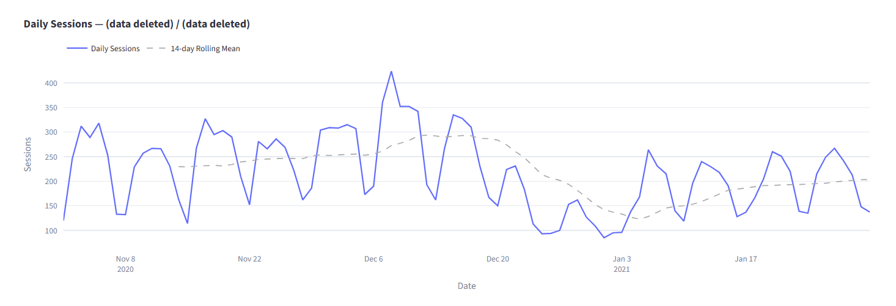
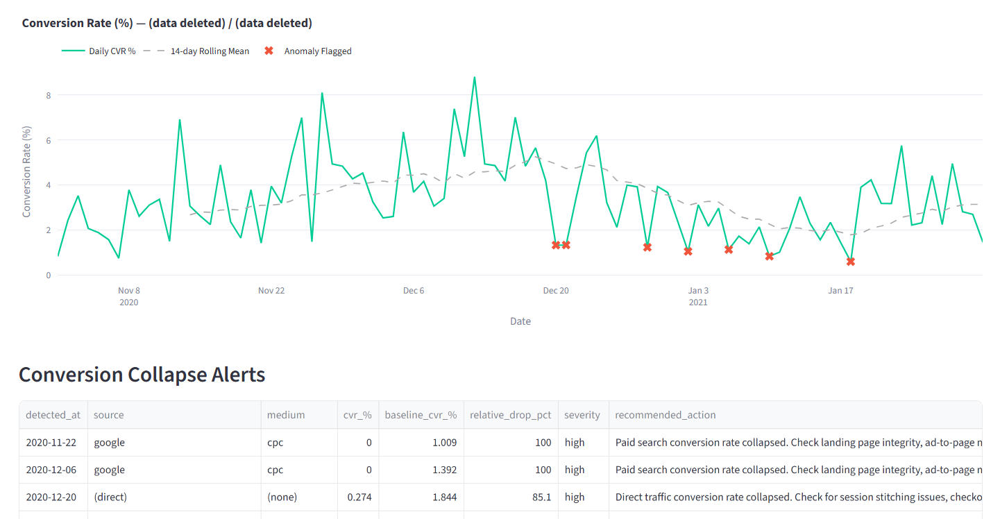
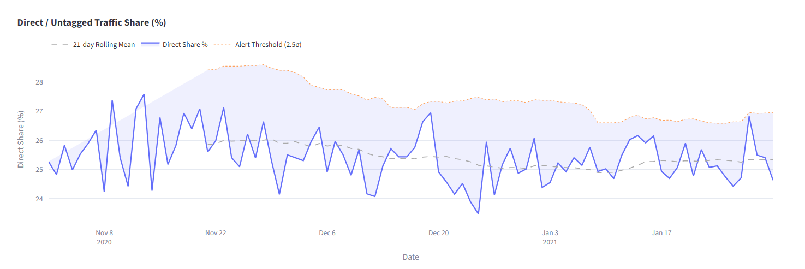
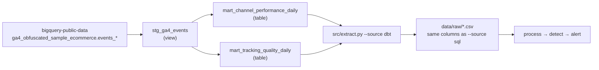

# Customer Journey Anomaly Detector

[](https://github.com/NguyenIslandBoy/customer-journey-anomaly-detector/actions/workflows/ci.yml)





A batch anomaly detection pipeline for GA4 marketing data, built on the
Google Merchandise Store public BigQuery dataset (a fixed sample,
2020-11-01 to 2021-01-31). It runs on demand; nothing is scheduled.

Monitors three operational signals that matter to any marketing or
analytics team:

| Anomaly Type | Signal | Method |
|---|---|---|
| Traffic Spike | Abnormal daily user volume by acquisition source/medium | Rolling Z-score (14-day, 3σ) |
| Conversion Collapse | User conversion rate drop vs rolling baseline | Relative drop threshold (60%, min 1pp absolute) |
| Untagged Surge | Share of users with acquisition medium `(none)` spikes | Rolling Z-score (21-day, 2.5σ) |

Volumes are **users** (distinct users with a `session_start`), not sessions,
and source/medium is GA4's user-level acquisition field, not the session's
source. See [Metric definitions](#metric-definitions).

## Architecture

```
BigQuery (GA4 public dataset)
    ↓
src/extract.py        ← --source sql (default): queries in sql/
                        --source dbt: reads the dbt marts (see "dbt layer")
                        saves to data/raw/
    ↓
src/process.py        ← cleaning, filtering, aggregation
    ↓
src/detect/           ← one module per anomaly type
    ↓
src/alert.py          ← merges alerts, assigns IDs and severity
    ↓
output/alerts.json    ← consumed by dashboard
    ↓
dashboard/app.py      ← Streamlit (reads only, no pipeline logic)
```

## Project Structure

```
customer-journey-anomaly-detector/
├── sql/                          # BigQuery SQL queries
├── src/
│   ├── extract.py                # BigQuery extraction
│   ├── process.py                # Data cleaning and aggregation
│   ├── detect/
│   │   ├── traffic_spike.py
│   │   ├── conversion_collapse.py
│   │   └── untagged_surge.py
│   ├── alert.py                  # Alert merging and output
│   └── run_pipeline.py           # Pipeline orchestrator
├── dashboard/
│   └── app.py                    # Streamlit dashboard
├── dbt/                          # dbt-bigquery project (staging view, 2 marts, tests)
├── scripts/
│   └── parity_check.py           # Legacy SQL vs dbt extracts and alerts
├── docs/
│   └── parity-check.md           # Recorded parity run
├── tests/                        # Pytest suite (39 tests)
├── output/                       # alerts.json written here
└── data/
    ├── raw/                      # BigQuery exports
    └── processed/                # Cleaned aggregations
```

## Setup

### Prerequisites
- Python 3.11 or 3.12 (CI uses 3.11). Python 3.13 does not work:
  `pyarrow==17.0.0` in `requirements.txt` has no wheel for it.
- Google Cloud project with BigQuery API enabled
- Service account with `BigQuery Data Viewer` and `BigQuery Job User` roles
  (the dbt layer also needs `BigQuery Data Editor` on its own dataset; see
  [dbt layer](#dbt-layer))

### Installation

```powershell
py -3.11 -m venv venv   # or py -3.12
.\venv\Scripts\python.exe -m pip install -r requirements.txt
```

### Configuration

```powershell
Copy-Item .env.example .env
# Edit .env with your GCP project ID and credentials path
```

### Run Pipeline

```powershell
# Full run (extracts from BigQuery + processes + detects)
.\venv\Scripts\python.exe -m src.run_pipeline

# Skip extraction (reuse existing data/raw/ files)
.\venv\Scripts\python.exe -m src.run_pipeline --skip-extract

# Extraction source: sql (default) runs the queries in sql/;
# dbt reads the dbt marts (see "dbt layer")
.\venv\Scripts\python.exe -m src.run_pipeline --source sql
```

### Run Dashboard

```powershell
.\venv\Scripts\python.exe -m streamlit run dashboard/app.py
```

### Run Tests

```powershell
.\venv\Scripts\python.exe -m pytest tests\ -v
```

## Detection Logic

### Traffic Spike
Computes a 14-day rolling mean and standard deviation of daily users per acquisition source/medium. Flags days where the Z-score exceeds 3.0. A minimum rolling std of 1.0 prevents false positives on near-flat series.

### Conversion Collapse
Computes a 14-day rolling mean of the user conversion rate (purchasers / users) per acquisition source/medium. Flags days where the relative drop from baseline exceeds 60% AND the absolute drop exceeds 1 percentage point. Minimum 30 users required on the flagged day to exclude noise from low-traffic sources.

### Untagged Surge
Computes the daily site-wide share of users with a `session_start` whose acquisition medium is `(none)`. Applies a 21-day rolling Z-score with a lower threshold of 2.5σ - tracking failures are operationally urgent, so sensitivity is deliberately higher.

## Key Design Decisions

**Why relative drop for CVR, not Z-score?**
Conversion rates are proportions bounded between 0 and 1, often right-skewed with small absolute values. A 60% relative drop (the threshold used here) has a clear business meaning; a Z-score on a proportion series is noisier and harder to explain to stakeholders.

**Why different rolling windows (14 vs 21 days)?**
Session volume changes day-to-day. Direct traffic share is a slower-moving structural metric - a longer window gives a more stable baseline and avoids flagging normal weekly seasonality.

**Why does the pipeline separate extract → process → detect → alert?**
Each layer is independently testable and replaceable. The Streamlit dashboard reads output files only - it never imports detection logic. This mirrors production ML system design where serving and training are decoupled.

## dbt layer

The three extracts are also built as tested dbt models on BigQuery. They
reproduce the legacy SQL output row for row ([parity check](docs/parity-check.md)).
The pipeline still defaults to `--source sql`; `--source dbt` is opt-in.



| Model | Type | Grain | Columns |
|---|---|---|---|
| `stg_ga4_events` | view | one GA4 event, all event names | `event_date` (DATE), `event_name`, `user_pseudo_id`, `ga_session_id`, `session_key`, `acquisition_source`, `acquisition_medium`, `transaction_id`, purchase revenue |
| `mart_channel_performance_daily` | table | day × source × medium | `users`, `session_count`, `purchasers`, `user_conversion_rate` |
| `mart_tracking_quality_daily` | table | day | `total_users`, `direct_users`, `direct_share`, `data_deleted_users`, `not_set_users`, `purchase_events`, `purchase_events_missing_transaction_id`, `purchase_events_duplicate_transaction_id` |

Tests (`dbt build`): `not_null` and `accepted_values` on staging,
uniqueness of each mart's grain, `not_null` keys, `direct_share` between 0
and 1, a warn-level `purchasers <= users`, and two singular tests. The first
checks that the channel users never sum below the site total; the second that
each mart covers exactly the expected days. Each singular test was shown to
fail on a corrupted copy of the mart output. CI runs `dbt parse` with
placeholder credentials; the models themselves are built and tested manually.

### Run it

The dataset must be in `US`, next to the public GA4 dataset: BigQuery cannot
read across locations. dbt writes, so the service account needs
`BigQuery Data Editor` on the `cja_dbt` dataset only. Keep the project-level
roles at Data Viewer and Job User.

```powershell
.\venv\Scripts\python.exe -m pip install -r requirements.txt -r requirements-dbt.txt

# dbt reads environment variables, not .env
$env:BQ_PROJECT_ID = "your-gcp-project-id"
$env:BQ_CREDENTIALS_PATH = "C:\full\path\to\credentials.json"

# One-time: create the dataset in US
bq --location=US mk --dataset "$($env:BQ_PROJECT_ID):cja_dbt"
# Then, in the console: dataset cja_dbt > Sharing > Permissions >
# add the service account as BigQuery Data Editor (this dataset only).

.\venv\Scripts\dbt.exe deps --project-dir dbt --profiles-dir dbt
.\venv\Scripts\dbt.exe build --project-dir dbt --profiles-dir dbt

# Pipeline from the marts (build them first; the pipeline does not run dbt)
.\venv\Scripts\python.exe -m src.run_pipeline --source dbt

# Compare legacy SQL and dbt extracts and alerts
.\venv\Scripts\python.exe scripts\parity_check.py
```

Optional: `DBT_DATASET` (default `cja_dbt`) and the dbt vars `start_date` /
`end_date` (default `20201101` / `20210131`) narrow or redirect the build.

### Cost

`dbt/profiles.yml` sets `maximum_bytes_billed` to 5 GB, so any single query
that would bill more fails instead of running. On 2026-10-13 a full
`dbt build` processed 2.57 GB in total, and the largest single query
(the channel mart, which reads `event_params` for `session_key`) processed 1.13 GB.
The legacy extraction scans about 0.78 GB.
The public sample does not change, so the marts only need building once.

## Metric definitions

| Pipeline name (CSVs, detectors) | dbt mart name | What it actually counts |
|---|---|---|
| `users` | `users` | Distinct `user_pseudo_id` with a `session_start` that day, per source/medium. **Users, not sessions.** |
| *(none)* | `session_count` | Distinct `user_pseudo_id` + `ga_session_id` with a `session_start`. True sessions. Summed over all rows, 2.3% higher than `users` (354,857 vs 346,808). |
| `purchasers` | `purchasers` | Distinct users with a `purchase` event. |
| `conversion_rate` | `user_conversion_rate` | `purchasers / users`; empty when `users` is 0. A user conversion rate, not a session conversion rate. |
| `total_users` | `total_users` | Distinct users with a `session_start` that day, site-wide. |
| `direct_users` | `direct_users` | Of those, users with acquisition medium `(none)`. |
| `direct_share` | `direct_share` | `direct_users / total_users`. |
| `source`, `medium` | `source`, `medium` | GA4 `traffic_source.source/medium`. Google documents these as the source that **first acquired the user**, not the session's source, so all channel figures here are acquisition-based. They are also not stable per user in this sample: on all 92 days, users summed across source/medium exceed the site total (by up to 696 a day), so some users appear under more than one source on the same day. |

Until 2026-10-13 the pipeline named `users`, `total_users` and `direct_users`
`sessions`, `total_sessions` and `direct_sessions`. Only the names changed; the
values and the alerts are identical. CSVs or alert files produced before then
use the old column names.

Values to read with care:

- `(data deleted)` is an obfuscation label in the public sample, not a
  tracking error. 20,054 users had it as their source over the 92 days.
- `<Other>` is the sample's bucket for low-volume values. `src/process.py`
  drops it before detection.
- `(not set)` never occurs as a source or medium in this sample, so
  `not_set_users` is 0 every day.
- Purchases: 906 of 5,692 purchase events have no usable `transaction_id`
  (23 null, 883 `(not set)`), and 335 repeat an id already seen
  (326 ids appear 2 to 4 times, 15 of them on different days). Summing
  revenue per event would double-count.

## Not in this repo

- **A Looker (or other BI) dashboard.** The GA4 sample has no ad cost, so channel
  ROI cannot be computed. The Streamlit app is for inspecting alerts only.
- **Live monitoring.** The data is a fixed public sample (2020-11-01 to
  2021-01-31). The pipeline runs on demand; nothing is scheduled.
- **Session-level channel attribution.** The export's source/medium is
  user-level acquisition, and the obfuscated sample does not carry a
  reliable session-level source.

## Limitations and Honest Notes

- The GMS dataset covers Nov 2020 – Jan 2021 (92 days). A longer
  history would improve rolling baselines for the first 2–3 weeks.
- Zero traffic spike and untagged surge alerts on this dataset reflect
  genuine stability in the public data, not detector failure. The test
  suite validates detector logic independently of the real data.
- `(data deleted)` is a GA4 obfuscation label in the public dataset,
  not a tracking error. In a production environment this would be a
  real source/medium value.

## Tests

39 tests, none of which touch the network: 7 for the CLI flags
(`tests/test_cli.py`), 10 for the extract modes and the CSV column
contract (`tests/test_extract_modes.py`, mocked BigQuery client), and 22 for
the detectors. Each detector is tested with:
- Stable series producing zero alerts
- Known anomaly injected at a specific date
- Low-volume filter behaviour
- Alert schema validation
- Severity threshold boundaries tested directly on `_build_alert`

```powershell
.\venv\Scripts\python.exe -m pytest tests\ -v
```
